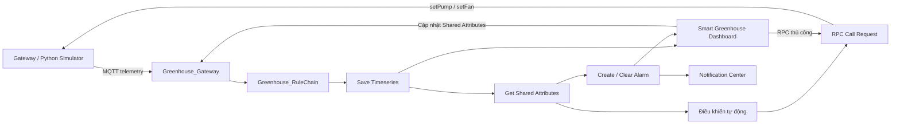
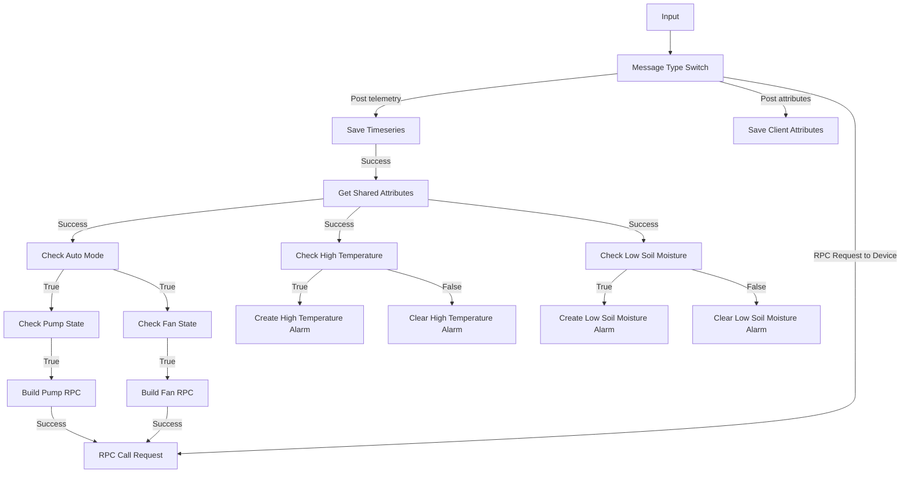

# Smart Greenhouse – CoreIOT

**CO3037 – Internet of Things | Học kỳ 261**

Module CoreIOT cung cấp giao diện giám sát môi trường và dinh dưỡng đất (NPK) trong nhà kính, điều khiển máy bơm và quạt thông gió theo chế độ thủ công/tự động, cảnh báo môi trường và thông báo trong ứng dụng.

## 1. Phạm vi thực hiện

| Nhiệm vụ | Nội dung | Trạng thái |
|---|---|---|
| T11 | Dashboard giám sát và điều khiển (17 widget) | Đã kiểm thử các chức năng chính trên simulator |
| T12 | RuleChain điều khiển tự động theo ngưỡng động | Đã quan sát bơm và quạt tự động bật/tắt trên simulator |
| T13 | Alarm và Notification | Đã quan sát tạo Alarm; Clear Alarm và Notification chưa xác nhận lại đầy đủ sau cập nhật |

Phạm vi hiện tại chỉ điều khiển bơm/quạt ON/OFF. Pump Level và LED Status tạm hoãn đến khi kiểm thử phần cứng; không có widget hoặc logic điều khiển theo mức bơm trong RuleChain hiện tại.

## 2. Cấu trúc thư mục

```text
coreiot/
├── README.md
├── dashboard.json
├── rulechain.json
└── tests/
    ├── requirements.txt
    └── simulate_telemetry.py
```

- `dashboard.json`: cấu hình Smart Greenhouse (17 widget).
- `rulechain.json`: cấu hình Greenhouse_RuleChain (16 node, 17 liên kết).
- `tests/`: chương trình giả lập thiết bị MQTT và các thư viện Python cần thiết.

## 3. Kiến trúc hệ thống



Logic tự động được thực hiện trên CoreIOT. Theo thiết kế, Gateway nhận lệnh RPC, chuyển lệnh xuống Node Center và chuyển telemetry về cloud. Simulator thay thế Gateway trong quá trình kiểm thử độc lập. Chưa xác nhận luồng điều khiển này trên phần cứng thật.

## 4. Triển khai trên CoreIOT

### 4.1. Import RuleChain

1. Đăng nhập [CoreIOT](https://app.coreiot.io/) bằng tài khoản có quyền quản trị tenant.
2. Vào **Rule chains**, chọn chức năng Import rule chain và tải `rulechain.json`.
3. Kiểm tra RuleChain có tên `Greenhouse_RuleChain`.
4. Giữ RuleChain này là non-root. Không thay đổi Root RuleChain của tenant.

### 4.2. Tạo Device Profile và Device

1. Vào **Profiles → Device profiles**, tạo `Greenhouse_Profile`.
2. Chọn **Default rule chain** là `Greenhouse_RuleChain` và lưu.
3. Vào **Entities → Devices**, tạo `Greenhouse_Gateway` và chọn profile vừa tạo.
4. Sử dụng thiết bị MQTT thông thường (không bật Is gateway cho cấu hình giả lập này).
5. Trong Device Details hoặc Manage credentials, sao chép Access Token để sử dụng khi kết nối MQTT.

Nếu các đối tượng đã tồn tại, kiểm tra và tái sử dụng thay vì tạo bản sao không cần thiết.

### 4.3. Khởi tạo Shared Attributes

Vào **Entities → Devices → Greenhouse_Gateway → Attributes → Shared attributes**, tạo ba thuộc tính:

| Key | Kiểu dữ liệu | Giá trị khởi tạo đề xuất | Ý nghĩa |
|---|---|---|---|
| `auto_mode` | Boolean | `false` | MANUAL; chuyển sang `true` (AUTO) khi cần kiểm thử tự động |
| `soil_threshold` | Integer | `40` | Ngưỡng độ ẩm đất (%) |
| `temp_threshold` | Integer | `35` | Ngưỡng nhiệt độ không khí (°C) |

Nhập đúng kiểu dữ liệu, không nhập Boolean dưới dạng chuỗi. Khi chạy với phần cứng thật lần đầu, nên chọn `auto_mode = false` cho đến khi xác nhận trạng thái relay và cảm biến an toàn.

Các giá trị trên là cấu hình khởi tạo, không phải ngưỡng hard-code trong RuleChain. Hai file JSON không lưu giá trị Shared Attributes thực tế của Device. Node Get Shared Attributes yêu cầu đủ cả ba key.

### 4.4. Import Dashboard

1. Vào **Dashboards**, chọn Import dashboard và tải `dashboard.json`.
2. Mở `Smart Greenhouse`, vào Edit mode và mở Entity aliases.
3. Chỉnh alias `Greenhouse` thành Single entity → Device → `Greenhouse_Gateway` của tài khoản đang triển khai.
4. Apply và Save Dashboard.

**Lưu ý:** JSON export tham chiếu UUID của Device gốc, nên phải kiểm tra và gán lại alias khi import sang môi trường khác.

### 4.5. Notification

Mở **Notification center → Rules** để kiểm tra cấu hình thông báo cho sự kiện Alarm created và Alarm cleared. Bảo đảm người dùng cần nhận thông báo thuộc nhóm người nhận được cấu hình và kênh Web/in-app được bật. Nếu tài khoản đã có rule phù hợp, tái sử dụng để tránh gửi trùng. Nếu chưa có, tạo rule và template phù hợp với hai loại Alarm ở mục 7.

Cấu hình Notification của tenant không nằm trong hai file JSON. Ở phiên bản trước, thông báo tạo và kết thúc Alarm đã xuất hiện ở biểu tượng chuông. Sau cập nhật telemetry, cần xác nhận lại cả hai sự kiện. Email/SMS chưa được kiểm thử.

## 5. Quy ước giao tiếp MQTT

### 5.1. Kết nối

| Thông số | Giá trị dùng khi giả lập |
|---|---|
| Broker | `app.coreiot.io` |
| Port | `1883` |
| Username | Access Token của `Greenhouse_Gateway` |
| Password | Không cần |
| QoS | 1 |
| Chu kỳ telemetry | 5 giây |

Không đưa Access Token vào mã nguồn, ảnh minh chứng hoặc GitHub. Port 1883 không mã hóa; chỉ dùng cấu hình này cho môi trường kiểm thử đã thiết lập. Khi triển khai thực tế, ưu tiên kết nối TLS theo cấu hình broker được cung cấp.

### 5.2. Telemetry

Publish topic: `v1/devices/me/telemetry`.

| Key | Kiểu dữ liệu | Đơn vị / ý nghĩa |
|---|---|---|
| `packet_id` | Integer | Mã gói dữ liệu |
| `rx_count` | Integer | Bộ đếm gói nhận |
| `temp` | Number | Nhiệt độ không khí (°C), một chữ số thập phân |
| `hum_air` | Number | Độ ẩm không khí (%), một chữ số thập phân |
| `hum_soil` | Integer | Độ ẩm đất (%) |
| `light` | Integer | Cường độ ánh sáng (%) |
| `nitrogen` | Integer | Hàm lượng Nitrogen (mg/kg) |
| `phosphorus` | Integer | Hàm lượng Phosphorus (mg/kg) |
| `potassium` | Integer | Hàm lượng Potassium (mg/kg) |
| `pump_level` | Integer | Mức bơm 0/1/2; tạm hoãn sử dụng trên Dashboard/RuleChain |
| `pump_state` | Boolean | Trạng thái bật/tắt máy bơm |
| `fan_state` | Boolean | Trạng thái bật/tắt quạt |
| `led_color` | String | GREEN/YELLOW/RED; tạm hoãn hiển thị và kiểm thử phần cứng |

Ví dụ payload của simulator:

```json
{
  "packet_id": 1,
  "rx_count": 1,
  "temp": 32.5,
  "hum_air": 65.8,
  "hum_soil": 42,
  "light": 75,
  "nitrogen": 50,
  "phosphorus": 65,
  "potassium": 80,
  "pump_level": 0,
  "pump_state": false,
  "fan_state": true,
  "led_color": "GREEN"
}
```

Simulator phát 13 key theo cấu trúc telemetry mới. Trong đó `pump_state` được suy ra từ `pump_level > 0`, còn `led_color` được ánh xạ theo mức 0/1/2. Đây là hành vi giả lập, không phải kết quả kiểm thử phần cứng. `packet_id` và `rx_count` bằng nhau trong mô hình truyền nhận lý tưởng của simulator.

Dashboard sử dụng 9 key cảm biến/trạng thái: `temp`, `hum_air`, `hum_soil`, `light`, `nitrogen`, `phosphorus`, `potassium`, `pump_state`, `fan_state`. RuleChain đọc `temp`, `hum_soil`, `pump_state`, `fan_state`; Save Timeseries vẫn lưu toàn bộ telemetry nhận được. Hai trạng thái phải là Boolean để tránh gửi RPC khi thiết bị đã ở đúng trạng thái mong muốn.

### 5.3. Server-side RPC

| Topic | Hướng |
|---|---|
| `v1/devices/me/rpc/request/+` | Gateway subscribe |
| `v1/devices/me/rpc/response/<requestId>` | Gateway publish phản hồi |

| Method | Params | Chức năng |
|---|---|---|
| `setPump` | Boolean | Đặt trạng thái máy bơm |
| `setFan` | Boolean | Đặt trạng thái quạt |
| `getPump` | Không cần | Đọc trạng thái bơm (simulator hỗ trợ) |
| `getFan` | Không cần | Đọc trạng thái quạt (simulator hỗ trợ) |
| `setPumpLevel` | Integer (0–2) | Simulator hỗ trợ; chưa sử dụng trong Dashboard/RuleChain |

Ví dụ yêu cầu bật máy bơm:

```json
{"method": "setPump", "params": true}
```

Simulator phản hồi Boolean cho `setPump` và `setFan` trên topic response có cùng request ID; trạng thái giả lập được báo lại trong telemetry tiếp theo. Với `setPump`, simulator và Gateway hiện ánh xạ `true` thành mức 2, `false` thành mức 0. Gateway hiện phản hồi JSON chứa `status: "OK"` và nội dung lệnh downlink; phản hồi này không xác nhận thiết bị vật lý đã thực thi thành công. Cần kiểm thử telemetry phản hồi từ phần cứng. Không dùng chuỗi `"true"` hoặc `"false"` thay cho Boolean trong RPC params.

Dashboard và RuleChain chỉ gửi `setPump` và `setFan`; không gọi `setPumpLevel` hoặc `setAutoMode`. Shared Attribute `auto_mode` điều khiển logic ở CoreIOT, không đồng nghĩa bật chế độ tự động cục bộ của firmware.

### 5.4. Shared Attributes qua MQTT

| Topic | Chức năng |
|---|---|
| `v1/devices/me/attributes` | Subscribe cập nhật thuộc tính |
| `v1/devices/me/attributes/request/1` | Yêu cầu cấu hình ban đầu |
| `v1/devices/me/attributes/response/+` | Subscribe phản hồi cấu hình |

Ví dụ payload yêu cầu cấu hình:

```json
{"sharedKeys": "auto_mode,soil_threshold,temp_threshold"}
```

Simulator đọc và ghi log cấu hình; logic quyết định tự động vẫn thuộc RuleChain.

## 6. Dashboard và điều khiển tự động

### 6.1. Dashboard (T11)

| Thành phần | Số lượng | Chức năng |
|---|---:|---|
| Gauge | 4 | Air Temperature (0–50°C, 1 chữ số thập phân), Light Intensity, Air Humidity, Soil Moisture (0–100%, 0 chữ số thập phân) |
| Time-series chart | 2 | Temperature Chart và Humidity Chart, 1 phút gần nhất, AVG theo khoảng 5 giây |
| Value Card | 3 | Nitrogen, Phosphorus, Potassium (mg/kg, 0 chữ số thập phân) |
| Single Switch | 3 | Water Pump, Ventilation Fan (ON/OFF), Auto Mode (AUTO/MANUAL) |
| Slider | 2 | Soil Moisture Threshold (0–100%), Temperature Threshold (0–50°C); ghi giá trị nguyên vào Shared Attributes |
| Alarms Table | 1 | System Alarms, cửa sổ thời gian 24 giờ gần nhất |
| HTML Card | 2 | Header tiếng Anh và User Guide tiếng Việt (tên nút tiếng Anh) |

Tổng cộng: **17 widget**. Giao diện chính sử dụng tiếng Anh; chưa có Pump Level và LED Status.

Khi `auto_mode = true`, Disabled state của hai Switch bơm/quạt đọc Shared Attribute `auto_mode` để khóa thao tác nhưng vẫn hiển thị trạng thái telemetry. Khi `auto_mode = false`, người dùng có thể điều khiển thủ công.

### 6.2. RuleChain thông minh (T12)



| Thiết bị | Điều kiện bật | Điều kiện tắt |
|---|---|---|
| Máy bơm | `hum_soil < soil_threshold` | `hum_soil >= soil_threshold` |
| Quạt | `temp > temp_threshold` | `temp <= temp_threshold` |

Node Get Shared Attributes đưa cấu hình vào metadata dưới dạng chuỗi với tiền tố `shared_`. Script JavaScript chuyển ngưỡng bằng `Number()` và kiểm tra `shared_auto_mode === "true"`. Hai nhánh điều khiển hoạt động độc lập. RPC chỉ được tạo khi trạng thái telemetry khác trạng thái mong muốn. RuleChain giữ nguyên 16 node, 17 liên kết; 10 node JavaScript được cập nhật theo telemetry mới. Các script đang sử dụng JavaScript (không chuyển sang TBEL vì script TBEL lưu kèm chưa được đồng bộ).

## 7. Alarm và Notification (T13)

| Alarm type | Severity | Điều kiện tạo | Điều kiện kết thúc |
|---|---|---|---|
| `High Temperature` | Major | `temp > temp_threshold` | `temp <= temp_threshold` |
| `Low Soil Moisture` | Warning | `hum_soil < soil_threshold` | `hum_soil >= soil_threshold` |

Hai nhánh Alarm nhận message từ Get Shared Attributes, độc lập với Check Auto Mode. Vì vậy, cảnh báo vẫn hoạt động trong chế độ thủ công. Alarm Details lưu giá trị cảm biến (`temp` hoặc `hum_soil`), `threshold`, `unit` và `message` bằng tiếng Anh; Clear Alarm bổ sung `clearTemperature` hoặc `clearSoilMoisture`, `clearThreshold` và `clearMessage`.

- Active: điều kiện cảnh báo đang tồn tại.
- Cleared: cảnh báo đã kết thúc, lịch sử vẫn được giữ.
- Acknowledged: người dùng đã xác nhận cảnh báo.
- Unacknowledged: người dùng chưa xác nhận cảnh báo.

Thông báo trong ứng dụng được xử lý bằng Notification Center của CoreIOT, không thêm node gửi thông báo riêng vào RuleChain.

## 8. Chạy simulator

Yêu cầu: Python 3, pip, kết nối Internet và Access Token hợp lệ. Mở terminal tại thư mục gốc repository.

Windows CMD:

```cmd
python -m pip install -r coreiot/tests/requirements.txt
set "COREIOT_ACCESS_TOKEN=YOUR_ACCESS_TOKEN"
python coreiot/tests/simulate_telemetry.py
```

PowerShell:

```powershell
python -m pip install -r coreiot/tests/requirements.txt
$env:COREIOT_ACCESS_TOKEN = "YOUR_ACCESS_TOKEN"
python coreiot/tests/simulate_telemetry.py
```

Thay `YOUR_ACCESS_TOKEN` bằng token thật trong terminal, không lưu vào source. Biến môi trường chỉ có hiệu lực trong phiên terminal tương ứng. Dừng simulator bằng Ctrl+C. Không chạy simulator và Gateway thật đồng thời trên cùng Device vì có thể gây xung đột telemetry và trạng thái.

Ví dụ log mong đợi:

```text
[MQTT] Connected successfully
[CONFIG] auto_mode = False
[CONFIG] soil_threshold = 40
[CONFIG] temp_threshold = 35
[CONFIG] auto_mode = True
[SEND] ...
[RPC] Received: setPump, params=True
[RPC] Response: True
```

## 9. Kiểm thử và kết quả

Simulator tạo dữ liệu ngẫu nhiên mỗi 5 giây: nhiệt độ 25–40°C, độ ẩm không khí 50–85%, độ ẩm đất 25–70%, ánh sáng 0–100% và mỗi chỉ số NPK 20–100 mg/kg. Đây là dữ liệu tổng hợp để kiểm thử, không phải ngưỡng dinh dưỡng khuyến nghị. Có thể đặt ngưỡng ngoài khoảng nhiệt độ/độ ẩm đất giả lập để kiểm thử ổn định.

| Thao tác trong chế độ tự động | Kết quả mong đợi |
|---|---|
| Ngưỡng đất 80% | Bơm bật; Low Soil Moisture Active |
| Ngưỡng đất 10% | Bơm tắt; Low Soil Moisture Cleared nếu đang Active |
| Ngưỡng nhiệt độ 18°C | Quạt bật; High Temperature Active |
| Ngưỡng nhiệt độ 45°C | Quạt tắt; High Temperature Cleared nếu đang Active |
| Tắt chế độ tự động | Mở khóa Switch; cảnh báo vẫn được xử lý |

Kết quả ghi nhận sau lần cập nhật telemetry và Dashboard:

| Hạng mục | Kết quả |
|---|---|
| 4 Gauge, 2 biểu đồ và 3 Value Card NPK | Đã quan sát hiển thị dữ liệu simulator |
| RPC bật/tắt bơm và quạt thủ công | Đã kiểm thử trên simulator |
| Điều khiển tự động bơm và quạt | Đã quan sát tự động bật/tắt trên simulator |
| Tạo Alarm tự động | Đã quan sát trên Dashboard |
| Clear Alarm, Notification và toàn bộ trường hợp biên | Chưa xác nhận lại đầy đủ sau cập nhật |
| Pump Level, LED Status và tích hợp phần cứng | Tạm hoãn / chưa kiểm thử |

Không đánh dấu toàn bộ test case là PASS. Đợt kiểm thử tích hợp cuối TC44–TC51 của phiên bản trước được bỏ qua; chưa xác nhận tích hợp với Gateway và phần cứng thật.

Sau khi kiểm thử giả lập, có thể đưa ngưỡng về 40% và 35°C.

## 10. Xử lý lỗi thường gặp

| Hiện tượng | Cách kiểm tra |
|---|---|
| Missing COREIOT_ACCESS_TOKEN | Khai báo lại biến môi trường trong terminal đang chạy |
| Dashboard không có dữ liệu | Kiểm tra token, MQTT, Device Profile và Entity Alias |
| Debug Events không xuất hiện | Bật All messages, lưu RuleChain, kiểm tra đường nối, Refresh Events |
| Events phản hồi chậm | Đồng bộ thời gian máy tính (Windows Date & time → Sync now), kiểm tra chu kỳ telemetry và kết nối |
| Script không hoạt động | Chọn JavaScript thay vì TBEL; kiểm tra Data/Metadata của Event OUT |
| Publish timeout | Kiểm tra mạng và MQTT PUBACK; timeout không tự chứng minh mất bản tin |
| Không nhận Notification | Kiểm tra Notification Rules, template, người nhận và kênh Web |

Tắt Debug khi không cần kiểm thử để hạn chế ghi log.

## 11. Giới hạn và lưu ý tích hợp

- Khóa điều khiển hiện tại nằm ở Dashboard, chưa chặn RPC thủ công từ mọi nguồn bên ngoài. Disabled state mặc định là false nếu chưa lấy được cấu hình.
- RuleChain chưa áp dụng hysteresis hoặc thời gian giữ trạng thái tối thiểu; cảm biến dao động quanh ngưỡng có thể khiến thiết bị bật/tắt thường xuyên. Cần đánh giá trước khi điều khiển phần cứng thật.
- Simulator lưu trạng thái thiết bị trong RAM; khởi động lại có thể làm trạng thái về false. Gateway thật phải báo trạng thái thực tế.
- Pump Level và LED Status chỉ được giữ trong cấu trúc telemetry giả lập để tương thích với dữ liệu firmware hiện tại; chưa triển khai trên Dashboard/RuleChain.
- Cần kiểm tra khả năng tương thích dữ liệu MQTT, điều khiển relay và phản hồi RPC khi tích hợp với Gateway thật.
- Không bật đồng thời logic tự động cục bộ của firmware và logic tự động trên CoreIOT khi chưa thống nhất cơ chế điều phối.
- Device, Device Profile, Shared Attributes và Notification Rules phải được thiết lập riêng khi tái triển khai.

